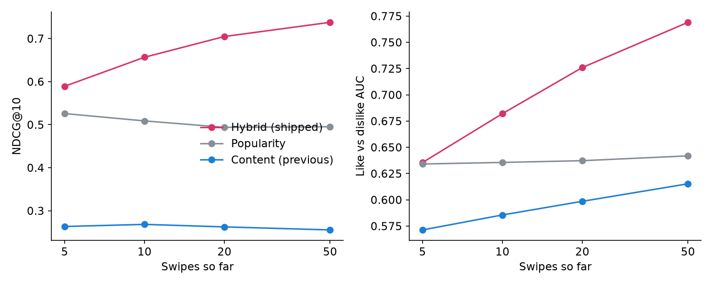
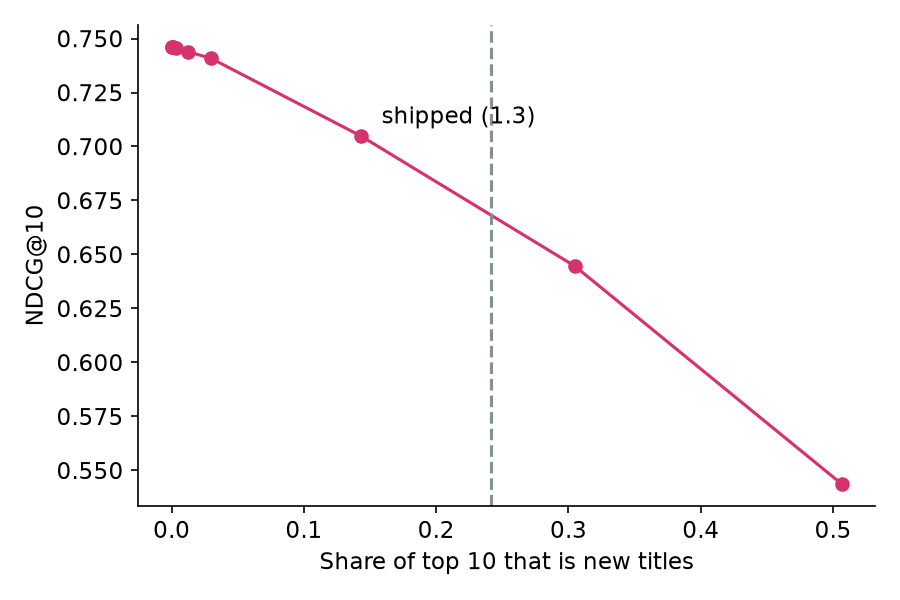

# How AniMatch learns taste

AniMatch used to rank anime by genre and tag overlap with your swipes. This folder replaces
that with a hybrid recommender and measures whether it is actually better.

**Result:** after 20 swipes, NDCG@10 rose from 0.262 to 0.705 and like-vs-dislike AUC from
0.599 to 0.726, on 10,000 users the model never saw. The model is 150 KB gzipped and runs in
the browser, with no server and no retraining per user.



| Swipes | Content (previous) NDCG@10 | Popularity | Hybrid (shipped) | Gain vs content, 95% CI | AUC: content → hybrid |
| --- | --- | --- | --- | --- | --- |
| 5 | 0.263 | 0.526 | 0.589 | +0.326 [0.321, 0.330] | 0.571 → 0.636 |
| 10 | 0.268 | 0.509 | 0.657 | +0.388 [0.384, 0.393] | 0.586 → 0.682 |
| 20 | 0.262 | 0.494 | 0.705 | +0.442 [0.438, 0.447] | 0.599 → 0.726 |
| 50 | 0.255 | 0.495 | 0.738 | +0.482 [0.478, 0.487] | 0.615 → 0.769 |

The most surprising finding: the previous model lost to a list of the most popular anime,
which ignores the user completely. That is partly unfair to it. It recommends much less
well-known titles (median popularity rank 275, against 5), and NDCG can only reward titles a
user chose to watch. That is why AUC is reported too. It asks whether, among titles a user
did watch, the liked ones rank above the disliked ones, which popularity helps with far less.
The hybrid wins on both, though popularity is only just behind it on AUC at 5 swipes.

## Method

- **Data:** a [MyAnimeList ratings dump](https://huggingface.co/datasets/profoz/anime_rating_complete)
  from around 2020 with 57.6M ratings, joined to the app's 1,500-title deck through AniList's
  `idMal`. 32.9M ratings match, and users need at least 20. Ratings map to swipes using the
  thresholds the app's list import uses. The data is not in this repo.
- **Split:** by user: 199,274 train, 24,909 validation, 24,909 test. Hyperparameters were chosen
  on validation users only. The app's users are always new to the model, so this is the
  realistic test, and it is harder than hiding a few ratings from known users.
- **Task:** N of a test user's ratings act as swipes and the rest are hidden. Each model ranks
  the deck, without sequels or already swiped titles. Differences use a paired bootstrap over users.
- **Baselines:** popularity and an exact port of the previous scorer.

| Model, 20 swipes | NDCG@10 | Recall@10 | AUC | Titles shown to anyone |
| --- | --- | --- | --- | --- |
| Popularity | 0.494 | 0.473 | 0.637 | 2% |
| Content (previous) | 0.262 | 0.250 | 0.599 | 74% |
| Item-kNN | 0.622 | 0.589 | 0.703 | 36% |
| Implicit matrix factorisation | 0.654 | 0.623 | 0.665 | 90% |
| EASE, full | 0.711 | 0.675 | 0.748 | 65% |
| **Hybrid: EASE (100 links per title) + content** | **0.705** | **0.669** | **0.726** | **64%** |

[EASE](https://arxiv.org/abs/1905.03375) won, so it ships. Its best regularisation was very
strong (λ = 100,000), which suits profiles this small.

## Decisions

- **Model size.** Full EASE is a 981 × 981 matrix. Keeping each title's 100 strongest links and
  rounding them to 8 bits costs 0.006 NDCG and takes the file to 568 KB, or 150 KB gzipped.
  Doubling the links gained little on validation users, while 30 links cost visibly more AUC.
- **New titles.** The ratings end around 2020, so 354 of the 1,129 titles in the deck have no CF
  data, and a plain CF model would never recommend them. To see what the fix costs, CF was
  retrained as if the 2018-2020 titles had no ratings. Content alone ranks those twice as well
  as random (NDCG 0.20 vs 0.10). Titles without CF data are therefore scored by content,
  multiplied by `cold_scale`. Shipping 1.3 takes the share of those titles in that experiment's
  top 10 from 0% to 14%, and lowers NDCG from 0.746 to 0.705. On the real deck they take 6-11%.
  That is a product choice: some accuracy on this metric is traded for showing recent anime.



## Limits

- **Offline is not live.** These numbers predict ratings on MyAnimeList, not swipes in AniMatch.
  An A/B test on real swipes is the check that would settle it, and it has not been done.
- **Popularity bias.** NDCG favours popular titles, so its gain overstates the real one. The AUC
  gains are the more cautious estimate, and they only cover users with 3+ disliked hidden
  titles, about 2,700 of the 10,000 per row.
- **Early swipes.** λ was tuned at 20 swipes. At 5 swipes Item-kNN beats the shipped model on both
  NDCG (0.635 vs 0.589) and AUC (0.666 vs 0.636), so the first few cards could improve.
- **Sampling.** Swipes are drawn at random from a user's ratings. Real swipes come in the order the
  deck serves them, and people who swipe differ from people who keep a MAL list.
- **Coverage.** Across users the hybrid shows a slightly smaller share of the deck than the previous
  model at 20 and 50 swipes (64% vs 74%, 54% vs 58%).

## Reproduce

```bash
cd ml
python3 -m venv .venv && .venv/bin/pip install -r requirements.txt
curl -L -o data/rating_complete.csv --create-dirs \
  https://huggingface.co/datasets/profoz/anime_rating_complete/resolve/main/rating_complete.csv
.venv/bin/python fetch_catalog.py   # the deck, from AniList
.venv/bin/python prepare.py         # swipe matrices and the user split
.venv/bin/python evaluate.py        # tuning, test results, results/metrics.json
.venv/bin/python export.py          # public/cf-model.json
.venv/bin/python plot.py
node test_parity.mjs                # browser scores must match Python
```

`test_parity.mjs` runs `public/recommender.js` on held-out profiles and checks it against the
evaluated Python model across 37,500 scores, so the numbers above describe the code users get.
